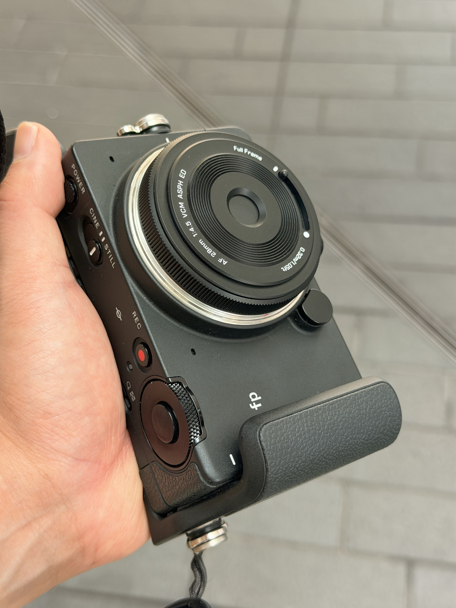
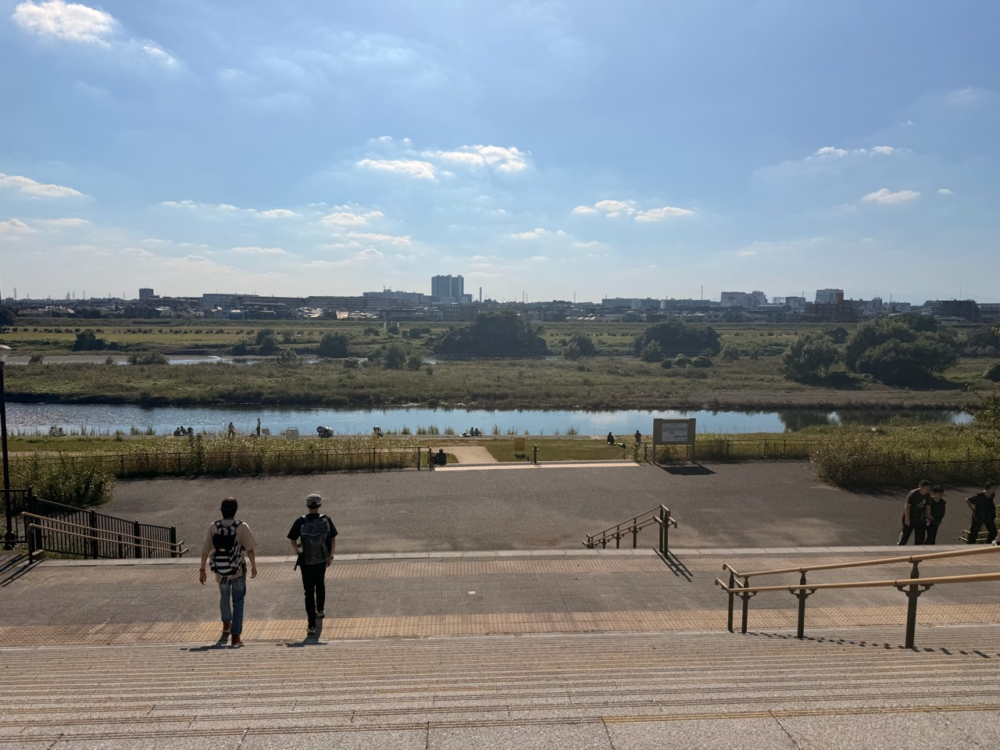
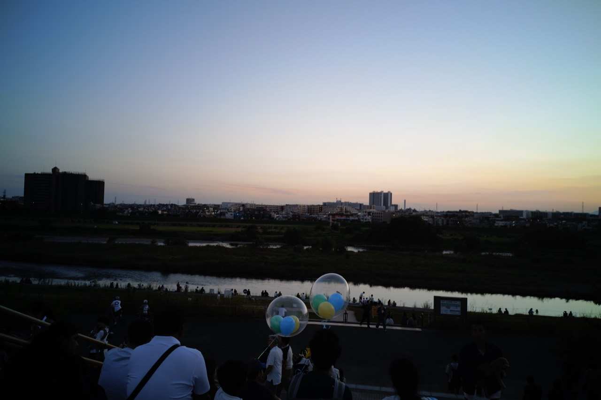
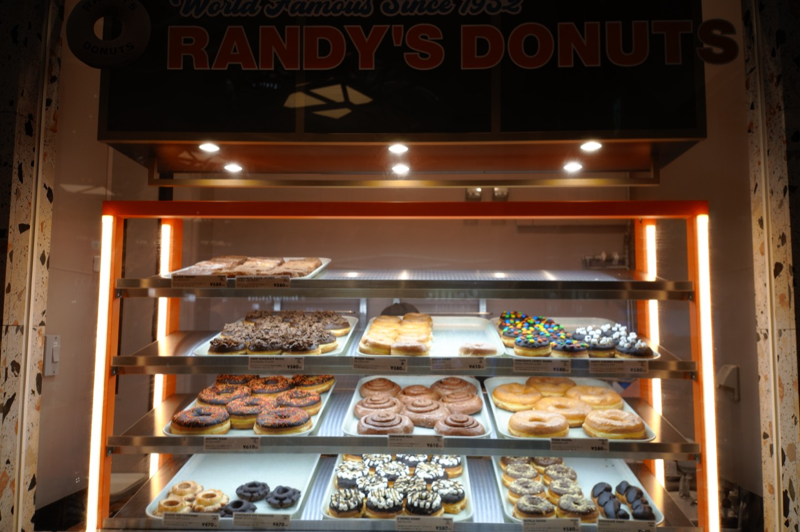
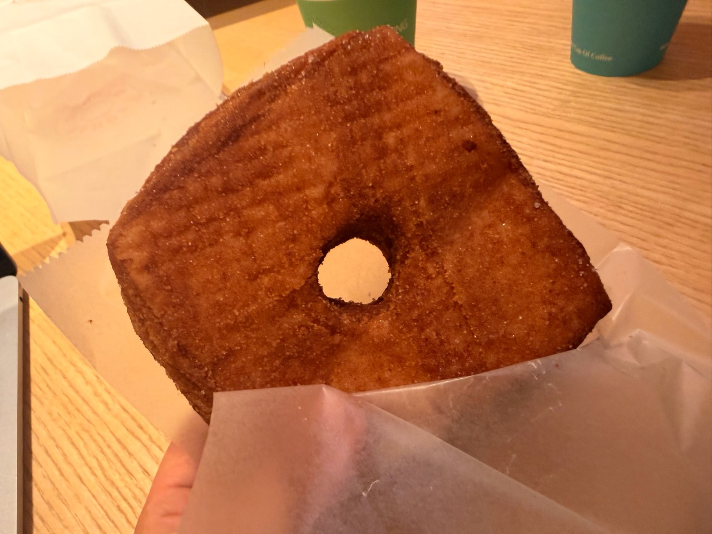
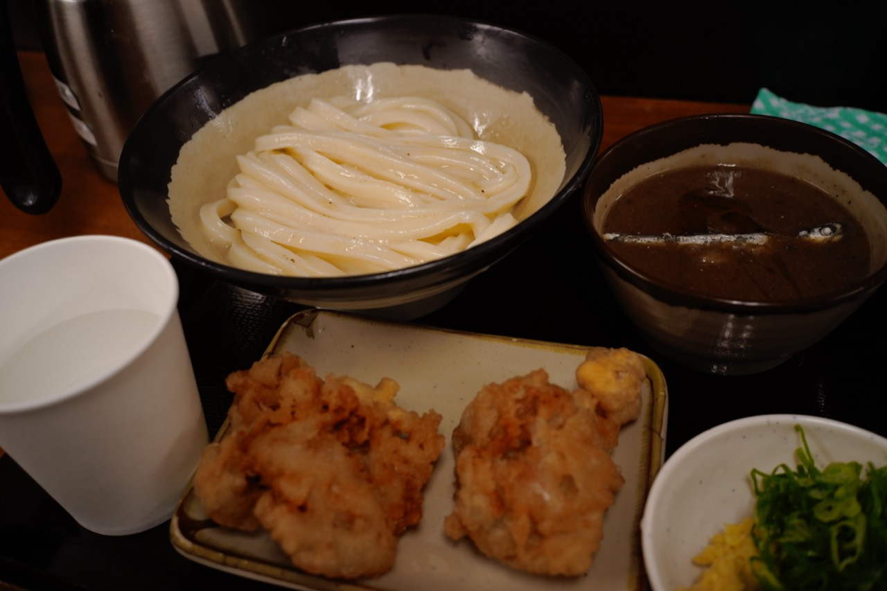
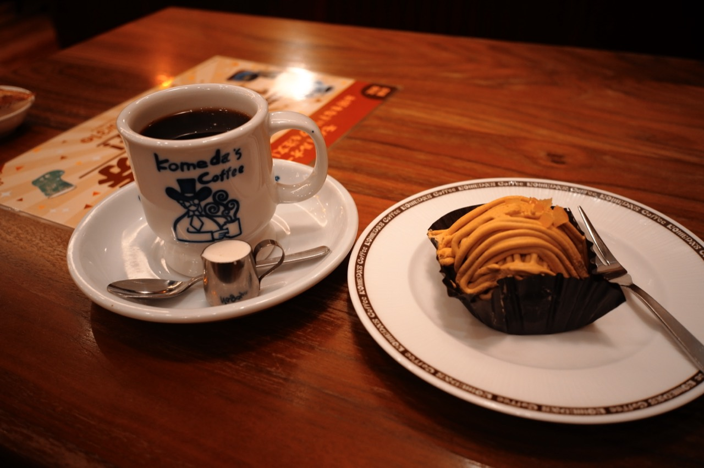

三連休にしたことを書いておく。

## 1日目 二子玉川でチェアリング

カメラの[レンズ](https://amzn.asia/d/0iBAo87F)を新しくした。
この記事の写真の一部はSIGMA fpで撮った。

会社の同僚と13時に二子玉川駅で集合した。
二子玉川ライズ周辺で食べ物やお酒を買って、二子玉川公園から河川敷に向かう芝生へ。
持ち寄った椅子に座って、17時半頃までだべったり食べたりしていた。

二子玉川ライズのデパ地下で買った焼き鳥や寿司などを食べた。
途中でスタバのコーヒートラベラーを頼んで、みんなでアイスコーヒーを飲んだ。
サーティワンでアイスも買って食べた。

そのあとは、みんなで蔦屋家電などを見て回った。ガジェット好きが多いので、こういうお店にも寄った。

### 焼肉のつもりがしゃぶしゃぶに

自分を含めた同期3人は家が近いので、そのまま自分の家で焼肉をすることになった。
ただ、うちにはホットプレートがなかった。閉店間際のスーパーには焼肉用の肉もなく、しゃぶしゃぶに変更した。

ところが、3人でつつく鍋もなかったので、別のスーパーで買ってきてもらった。
てんやわんやだったが、普通においしかった。

日本酒も持ち寄って、ちいかわを観ながらしゃぶしゃぶを食べて、お酒を飲んだ。楽しかった。

## 2日目 ISUCONの練習とランディードーナツ

ISUCONに備えて、チームで去年のISUCONの問題を解いていた。
AIと一緒に、流れを予習するような感じだった。

休憩でランディードーナツ（RANDY'S DONUTS）へ行った。

初めて食べたけど、おいしかった。あと、めちゃくちゃでかかった。
甘めのドーナツが多く、一つ一つが大きい。今回は2つ食べた。

## 3日目 吉祥寺

今週は友人の結婚式があるので、身なりを整えるweekだった。
眉毛サロンは済んでいたので、吉祥寺へ髪を切りに行った。

前髪は目にかかるくらいにしてもらったが、確認したときに少し長い気がして「もう少し切ってください」とお願いした。
でも、今になって思うと、確実に追加で切ってもらわないほうがよかった。

美容師さんはドライヤーで癖を伸ばすのがうまいので、そのときは長く感じた。
家で自分でドライヤーをすると、そんなに癖が伸びない。結果、前髪を短く切りすぎてしまった。

帰りに「いぶき」といううどん屋で濃厚つけうどんを食べた。

つけ汁はいりこの味が濃縮されていて、少し癖があった。
生姜とネギを入れて、酢をたっぷりかけて食べるとおいしかった。
最後はスープ割りにして、つけ汁を全部飲んだ。これもおいしかった。

そのあとはコメダでコーヒーを飲みながら少し作業した。

作業を終えて帰宅した。
