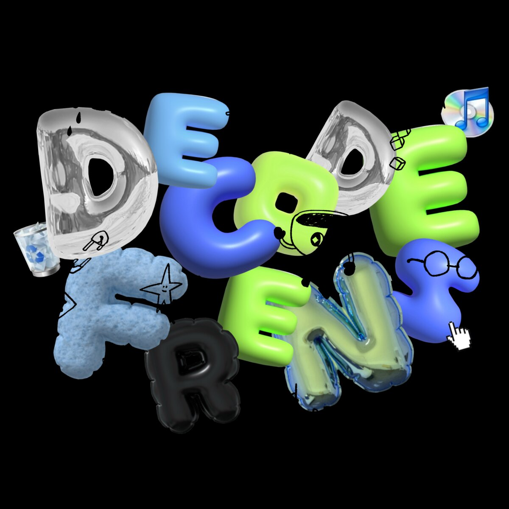

2026-11-21（土）のDecode Frensで、「Frens」という展示を出します。

- **日時**: 2026-11-21（土）14:00〜19:00
- **会場**: Crypto Cafe&Bar
- **主催**: Centrum

音楽とハンドドリップコーヒーの会です。展示はテーブルの一角にあります。

## Frens ってなに

2枚のNFCカードを、左右のリーダーに同時にかざすと、その2人が「Frens」になる展示です。

Decode Frensは、人間関係をデコードするイベントです。
実際にオフラインで会った人どうしが、カードをかざしてつながっていきます。

## 遊び方

1. はじめてカードをかざすと、登録用のQRが出ます。スマホでプロフィール（表示名とXのハンドル）を登録します。
2. 友だちと一緒に、2枚のカードを左右のリーダーに同時にかざします。
3. 画面で手と手が握手して、「Frens!」と出たら、2人はFrensです。

会場には、コーヒーのカードもあります。
自分のカードとコーヒーのカードを一緒にかざすと、「そのコーヒーを飲んだ」ことが記録されます。

## つながりの図

Frensになった記録は、線でつながったネットワーク図になります。
展示機では、Frensになった2人それぞれのまわりのつながりを見せます。
スマホでも、会場の人や参加した人が図を見られます。

## カードに記録が残る

Frensになった相手は、自分のカードの中にも書き込まれます。
イベントが終わっても、カードを読めば誰とFrensになったかがわかります。

当日、会場でFrensになりましょう。
