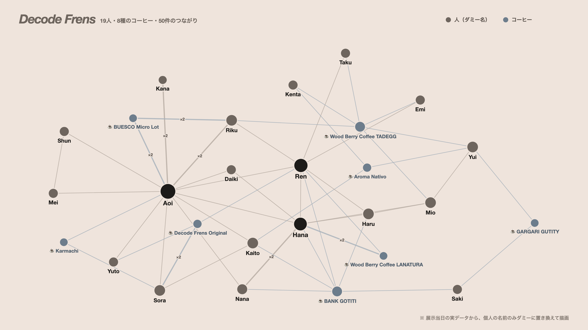
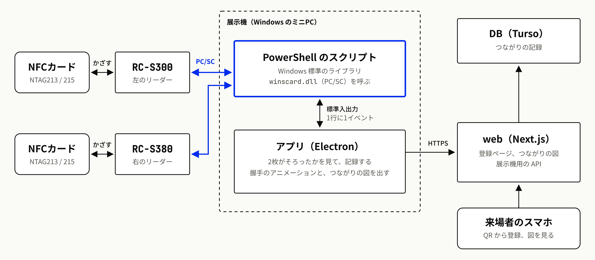
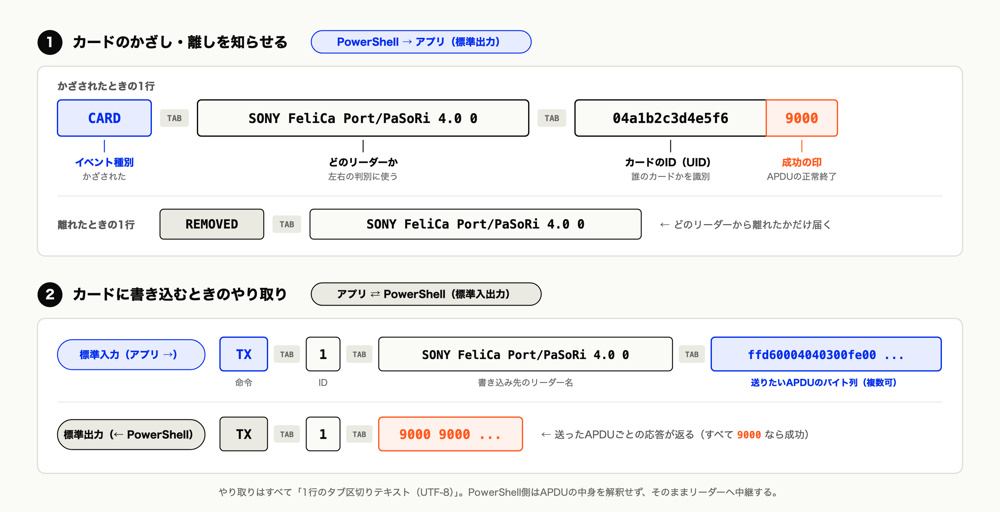
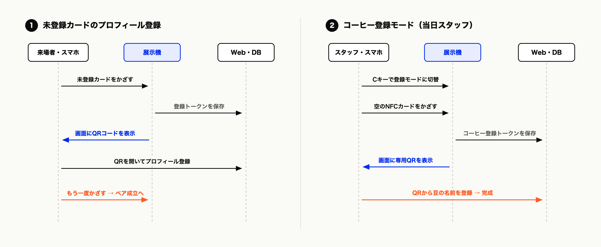

「Decode Frens」でHandShakeを展示しました。

- **会期**: 2026-11-21（土）14:00〜19:00
- **会場**: Crypto Cafe&Bar
- **主催**: Centrum

<blockquote className="twitter-tweet" data-dnt="true" align="center"><a href="https://twitter.com/0xCentrum/status/2118295311651332546">Centrum (@0xCentrum) のポスト</a></blockquote>
<blockquote className="twitter-tweet" data-dnt="true" align="center"><a href="https://twitter.com/seiya_oht/status/2123687287691345964">@seiya_oht のポスト</a></blockquote>

## HandShake

2枚のNFCカードをかざすことで出会いやつながりを記録するシステム。

大まかな流れはこんな感じ。

1. 左右のリーダーにNFCカードを1枚ずつかざす
2. 画面にデコード中〜握手の演出が流れる
3. 2人のつながりがカードとWebのマップに記録される

カードにはつながりマップのURLも書き込んでいるので、あとからスマホをかざすとそのままマップを開ける。

## 構成

展示機はWindowsのミニPCにNFCリーダーを2台つないで動かしている。
図の青い線がPC/SCでリーダーとやり取りしている部分。

## 実装のポイント

### SDKなしでNFCリーダーを動かす

リーダーはSonyのPaSoRi（RC-S300とRC-S380）を1台ずつ使った。
NFCリーダーを触るときはまずメーカーのSDKやnpmのライブラリを探しがちだが、今回はどちらも使っていない。

[PC/SC](https://pcsclite.apdu.fr/api/group__API.html)というICカードリーダー用の標準規格に対応していれば、Windows標準の`winscard.dll`経由で直接カードを読み書きできる。
RC-S300はWindows標準のドライバーでそのまま動き、RC-S380はソニーのNFCポートソフトウェアを入れればPC/SCリーダーとして認識される。

カードはNTAG213/215を使った（amiiboなどにも入っている定番のチップ）。
NTAG213のユーザー領域は144バイトで、4バイトごとのページに分かれている。読み書きに使ったAPDU命令はこの3つだけ。

| 命令（APDU） | すること |
| --- | --- |
| `FF CA 00 00 00` | カードのID（UID）を読む |
| `FF B0 00 <ページ> 10` | ページから16バイト読む |
| `FF D6 00 <ページ> 04 <4バイト>` | ページに4バイト書く |

ただ、Node.jsから`winscard.dll`を直接叩くのはネイティブアドオンのビルドなどがあって面倒だった。
そこでリーダーの監視だけPowerShellで小さなスクリプトを書いた。PowerShellはC#をそのまま埋め込んで`winscard.dll`を呼べるので、追加のライブラリやビルドツールを入れなくて済む。

スクリプトとElectronアプリのやり取りは、標準入出力のタブ区切りテキスト（1行ずつ）だけにしている。

カードのかざし・離しは標準出力から飛んでくるので、Electron側は1行ずつ読むだけ。書き込みも`TX`で始まる1行にAPDUのバイト列を並べて標準入力へ渡せば、結果が標準出力で返ってくる。

ひとつハマったのは文字コード。
Windows PowerShell 5.1はBOMなしファイルをShift_JIS（CP932）として読むので、スクリプトに日本語を入れると壊れる。結局英数字だけで書いた。

### 途中で離されても壊れないように書く

カードへの書き込みは既存データへの追記ではなく、毎回DBから最新のデータを取り直して丸ごと上書きする作りにした（すでに最新なら書き込まない）。壊れたデータへ追記してしまう事故を防げるし、書き込みに失敗しても次にかざしたときに最新状態で書き直される。

展示だと書き込み中にカードを離されることもあるので、書き込み順も工夫している。最初に先頭へ「中身は空」と書いてから本文を書き込み、最後に先頭へ本文の長さを書いて読み戻して確かめる手順にした。途中で離されても空のカードとして読めるので、次にかざしたときにやり直せる。

### 当日の運用に合わせた登録まわり

展示の現場でそのまま回せるように、カード登録の仕組みも展示機に組み込んだ。

- **未登録カードのスマホ登録**: まだ登録のないNFCカードをかざすと、相手を待たずに画面へQRコードが出る。来場者がスマホで読み取ってプロフィールを登録すると、次にかざしたときからそのままつながりを記録できる。
- **コーヒー登録モード**: 当日会場で提供されるコーヒーもその場で登録する必要があったので、展示機側で切り替えられるコーヒー登録モード（`C`キー）を作った。モード中にNFCカードをかざすと専用QRが出て、スマホから豆の名前などを登録してコーヒーカードにできる。

## 動き

展示機の画面は、特に動きにこだわって作った。

- Topの待ち受けアニメーション
- 人と人でFrensになるときの握手アニメーション
- コーヒーと人をかざしたときのカップを受け取るアニメーション

握手やカップのアニメーションはLottieだが、After Effectsは使っていない。
Fluent Emojiの3Dの手を素材にして、Node.jsのスクリプトで1フレームずつ位置と角度を計算し、LottieのJSONを直接吐き出している。ぶつかる直前の溜めや当たったあとの弾みをコードでそのまま調整できたのがよかった。

## 振り返り

上で書いた未登録カードの登録フローだが、実際よかったかというと、あまりよくなかった。

「展示機にかざす → 画面に出たQRコードをスマホで読み取って登録する → もう一度展示機にかざす」という流れはちょっと煩雑で、せっかくNFCカードを使っているのにQRコードを経由させてしまっていた。あらかじめ各NFCカードに登録用の一意のURLを書き込んでおいて、来場者が自分のスマホにカードをかざすだけでプロフィール登録まで済ませられるようにしておくほうがよかったなと思っている。

## 参考

- [PC/SC API](https://pcsclite.apdu.fr/api/group__API.html)
- [Sony RC-S300/S仕様（PC/SC 2.0）](https://www.sony.co.jp/en/Products/felica/business/data/RC-S300-S_E.pdf)
