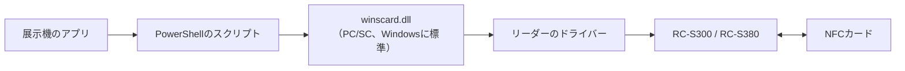

「Decode Frens」でHandShakeを展示しました。

- **会期**: 2026-11-21（土）14:00〜19:00
- **会場**: Crypto Cafe&Bar
- **主催**: Centrum

<blockquote className="twitter-tweet" data-dnt="true" align="center"><a href="https://twitter.com/0xCentrum/status/2118295311651332546">Centrum (@0xCentrum) のポスト</a></blockquote>
<blockquote className="twitter-tweet" data-dnt="true" align="center"><a href="https://twitter.com/seiya_oht/status/2123687287691345964">@seiya_oht のポスト</a></blockquote>
<script async src="https://platform.twitter.com/widgets.js" charset="utf-8"></script>

## HandShake

フォローひとつで、つながりは増える。そして、薄れていく。
なぜこの人とつながったのか、いつか思い出せなくなる。

HandShakeは、NFCカードを使って、人やモノとのつながりを記録する装置である。
二人が同時にカードをかざすと、そのつながりは、その場で受け取ったカードに書き込まれる。


## 実装

### SDKがなくても、カードリーダーは使える

今回いちばんの発見は、PC/SCを使えば、メーカーのSDKがなくてもNFCカードリーダーを使えることだった。

リーダーはSonyのPaSoRiで、RC-S300とRC-S380を1台ずつ使った。
NFCリーダーを使うときは、ついメーカーのSDKや専用のライブラリを探してしまう。
今回はどちらも使っていない。

PC/SC（Personal Computer/Smart Card）は、PCからICカードリーダーを使うための標準の仕様である。
Windowsには、PC/SCを使うための部品（`winscard.dll`）が最初から入っている。
リーダーのドライバーがPC/SCに対応していれば、アプリはメーカーを気にせず、同じ方法でカードに命令を送れる。
RC-S300もRC-S380も、PC/SCに対応している。



カードに送る命令は、APDUという決まった形のバイト列で書く。
カードはNTAG213/215という、NFCのシールやカードによく使われているチップで、amiiboにも使われている。
NTAG213なら144バイトの小さなメモリを持っていて、4バイトずつの「ページ」に区切られている。
このカードを読み書きするのに必要な命令は、次の3つだけだった。

| 命令（APDU） | すること |
| --- | --- |
| `FF CA 00 00 00` | カードのID（UID）を読む |
| `FF B0 00 <ページ> 10` | ページから16バイト読む |
| `FF D6 00 <ページ> 04 <4バイト>` | ページに4バイト書く |

つまり、このバイト列を`winscard.dll`に渡せれば、カードを読み書きできる。

`winscard.dll`をNode.jsから直接呼ぶのは少し面倒なので、Windowsに標準で入っているPowerShellで、リーダーとのやり取りだけを受け持つ小さなスクリプトを書いた。
PowerShellからはC#のコードを書いて`winscard.dll`を呼べるので、追加で何かをインストールする必要がない。

このスクリプトは2台のリーダーを見張り、カードが置かれたり離されたりするたびに、1行ずつ書き出す。

```text
CARD	SONY FeliCa Port/PaSoRi 4.0 0	04A1B2C3D4E5F69000
REMOVED	SONY FeliCa Port/PaSoRi 4.0 0
```

展示機のアプリ（Electron）は、この行を読むだけで、カードがかざされたことがわかる。
カードに書くときも、スクリプトに命令のバイト列を渡すだけである。

ひとつハマったのは文字コードで、Windows PowerShell 5.1は、BOMのないファイルを日本語のWindowsではShift_JIS（CP932）として読む。
スクリプトに日本語を書くと壊れるので、このスクリプトは英数字だけで書いている。

### そのほかの工夫

- **「同時に」は2秒**：2人が完全に同じ瞬間にカードを置くことはまずない。1枚目をかざしてから約2秒以内に反対側にカードが来たら、ペアとして扱う。
- **途中で離されても壊れないように書く**：カードはすぐに離される。最初に「中身は空」という印を書いてから本文を書き、最後に完成させる。途中で離されても空のカードとして読めるので、次にかざしたときに書き直せる。

## 演出

1枚目をかざすと、反対側に「もう1枚、かざしてください」と円が出て、残り2秒に合わせて縮んでいく。

2枚がそろうと、まず読み込みの画面になる。
左右の名前は、文字数だけを合わせた化けた文字で回している。
「関係をデコードしている」ように見せるためである。

続いて、左右から手が近づいて握手し、「FRENS!」の文字が出る。
コーヒーのカードと一緒にかざしたときは、手がテイクアウトのカップを受け取る動きになる。

この握手はLottie（アニメーションをJSONで表してWebで再生できる形式）で作っているが、After Effectsは使っていない。
Fluent Emojiの3Dの手の画像を使い、Node.jsのスクリプトでLottieのJSONを書き出している。
手の位置と角度を1フレームずつ計算するので、ぶつかる瞬間に向けて溜めて、当たったら弾む、という緩急をコードで直接調整できた。
