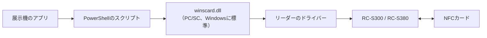

「Decode Frens」でHandShakeを展示しました。

- **会期**: 2026-11-21（土）14:00〜19:00
- **会場**: Crypto Cafe&Bar
- **主催**: Centrum

<blockquote className="twitter-tweet" data-dnt="true" align="center"><a href="https://twitter.com/0xCentrum/status/2118295311651332546">Centrum (@0xCentrum) のポスト</a></blockquote>
<blockquote className="twitter-tweet" data-dnt="true" align="center"><a href="https://twitter.com/seiya_oht/status/2123687287691345964">@seiya_oht のポスト</a></blockquote>
<script async src="https://platform.twitter.com/widgets.js" charset="utf-8"></script>

## HandShake

フォローひとつで、つながりは増える。そして、薄れていく。
なぜこの人とつながったのか、いつか思い出せなくなる。

HandShakeは、NFCカードを使って、人やモノとのつながりを記録する装置である。
二人が同時にカードをかざすと、そのつながりは、その場で受け取ったカードに書き込まれる。


## 実装

全体の構成は次のとおりである。
青い線が、リーダーとやり取りするPC/SCの部分にあたる。


### SDKがなくても、カードリーダーは使える

今回いちばんの発見は、PC/SCを使えば、メーカーのSDKがなくてもNFCカードリーダーを動かせることだった。

リーダーはSonyのPaSoRiで、RC-S300とRC-S380を1台ずつ使った。
NFCリーダーを使うとなると、まずメーカーのSDKや専用のライブラリを探してしまうが、今回はどちらも使っていない。

PC/SC（Personal Computer/Smart Card）は、PCからICカードリーダーを扱うための標準規格である。
Windowsには、PC/SCを使うためのライブラリ（`winscard.dll`）が最初から入っている。
リーダーがPC/SCに対応していれば、どのメーカーのものでも、同じ方法でカードを読み書きできる。
RC-S300もRC-S380も、PC/SCに対応している。



カードを読み書きするときは、リーダーに、APDUという決まった形のバイト列を命令として送る。
使ったカードのチップはNTAG213/215で、NFCのシールやカードによく入っている。amiiboもこのチップである。
メモリは小さく、NTAG213なら144バイトしかない。中は4バイトごとの「ページ」に区切られている。
このカードを読み書きするのに必要な命令は、3つだけだった。

| 命令（APDU） | すること |
| --- | --- |
| `FF CA 00 00 00` | カードのID（UID）を読む |
| `FF B0 00 <ページ> 10` | ページから16バイト読む |
| `FF D6 00 <ページ> 04 <4バイト>` | ページに4バイト書く |

このバイト列を`winscard.dll`に渡せば、カードを読み書きできる。

ただ、`winscard.dll`をNode.jsから直接呼ぶのは少し面倒である。
そこで、リーダーとのやり取りだけを受け持つ小さなスクリプトを、Windowsに標準で入っているPowerShellで書いた。
PowerShellはC#のコードを埋め込んで`winscard.dll`を呼べるので、何も追加でインストールしなくてよい。

このスクリプトは2台のリーダーを見張り、カードが置かれたり離されたりするたびに、1行ずつ出力する。

```text
CARD	SONY FeliCa Port/PaSoRi 4.0 0	04A1B2C3D4E5F69000
REMOVED	SONY FeliCa Port/PaSoRi 4.0 0
```

展示機のアプリ（Electron）は、この行を読むだけで、カードがかざされたとわかる。
カードに書くときも、命令のバイト列をスクリプトに渡すだけで済む。

ひとつハマったのは文字コードだった。
Windows PowerShell 5.1は、BOMのないファイルを、日本語のWindowsではShift_JIS（CP932）として読む。
スクリプトに日本語を書くと壊れるので、英数字だけで書いている。

### そのほかの工夫

- **「同時に」は2秒**：2人がぴったり同じ瞬間にカードを置くことは、まずない。そこで、1枚目がかざされてから約2秒以内に反対側にもカードが来たら、ペアとして扱っている。
- **途中で離されても壊れないように書く**：展示では、書き込みが終わる前にカードを離されることがある。そこで、最初に「中身は空」という印を書き、それから本文を書いて、最後に完成の印を付けている。途中で離されたカードは空のカードとして読めるので、次にかざしたときに書き直せる。

## 演出

1枚目をかざすと、反対側に「もう1枚、かざしてください」という文字と円が出る。円は、残りの2秒に合わせて縮んでいく。

2枚がそろうと、まず読み込みの画面になる。
左右の名前は、文字数だけを合わせた文字化けのような文字が、次々に入れ替わる。
関係をデコードしているように見せるための演出である。

続いて、左右から手が近づいて握手し、「FRENS!」の文字が出る。
コーヒーのカードと一緒にかざしたときは、握手の代わりに、手がテイクアウトのカップを受け取る。

握手のアニメーションはLottie（アニメーションをJSONで表し、Webで再生できる形式）だが、After Effectsは使っていない。
Fluent Emojiの3Dの手の画像を素材にして、Node.jsのスクリプトでLottieのJSONを書き出している。
手の位置と角度を1フレームずつ計算しているので、ぶつかる直前に溜めて、当たったら弾む、といった緩急をコードで直接調整できた。
