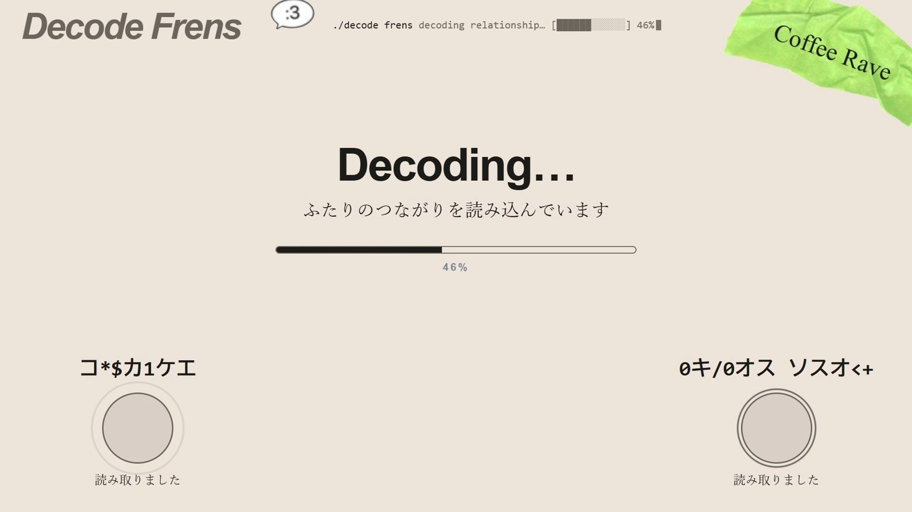
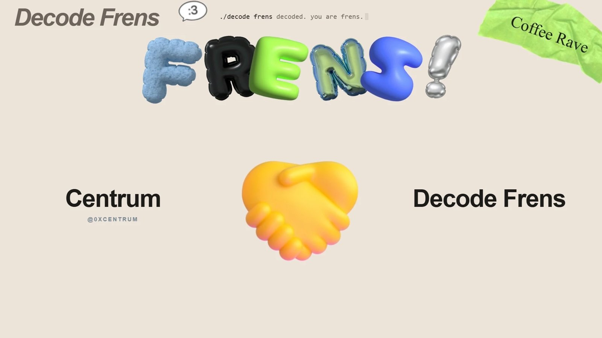

**HandShake** 
2026 
NFCカード、NFCリーダー（2台）、PC、ディスプレイ

## 作品について

HandShakeは、NFCカードを使って、人やモノとのつながりを記録する装置である。

左右に置かれた二つのリーダーに、二人が同時にカードをかざす。

画面の上で二つの手が近づき、握手を交わす。
その瞬間、二人は「Frens」として記録される。

手のひらに収まる一枚のカードは、出会いを受け取る器でもある。
Frensになった相手の名前は、カードの中にも書き込まれる。
会場を離れても、カードは誰と手を交わしたかを覚えている。

## 人と、モノと

つながる相手は、人だけではない。
会場のコーヒーにも、それぞれカードが用意されている。
自分のカードとコーヒーのカードを重ねると、その一杯を飲んだことが記録される。

## 浮かび上がる関係

記録されたつながりは、点と線のネットワークとして描かれる。
握手を交わした二人のまわりに、それぞれのFrensが浮かび上がる。

## Decode Frens

本作は、人間関係をデコードするイベント「Decode Frens」のために制作した。
画面越しではなく、同じ場所で実際に出会った人どうしが、カードをかざしてつながっていく。

## 展示情報

- **会期**: 2026-11-21（土）14:00〜19:00
- **会場**: Crypto Cafe&Bar
- **主催**: Centrum
