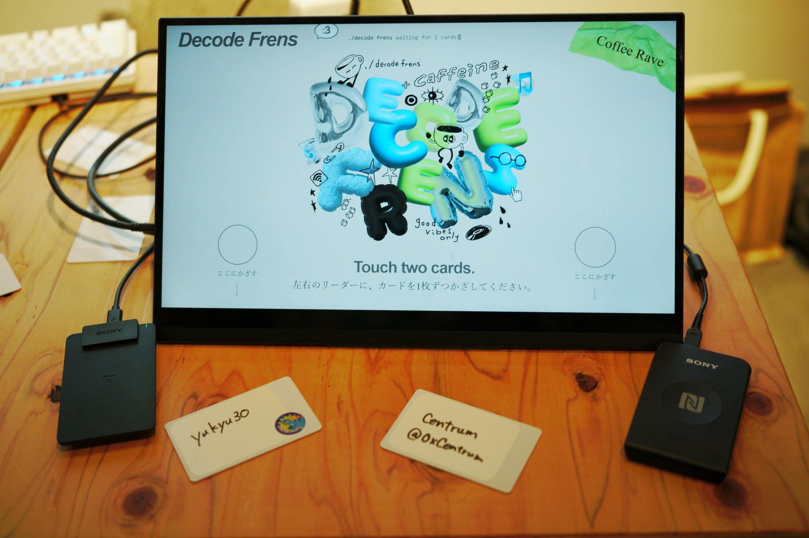
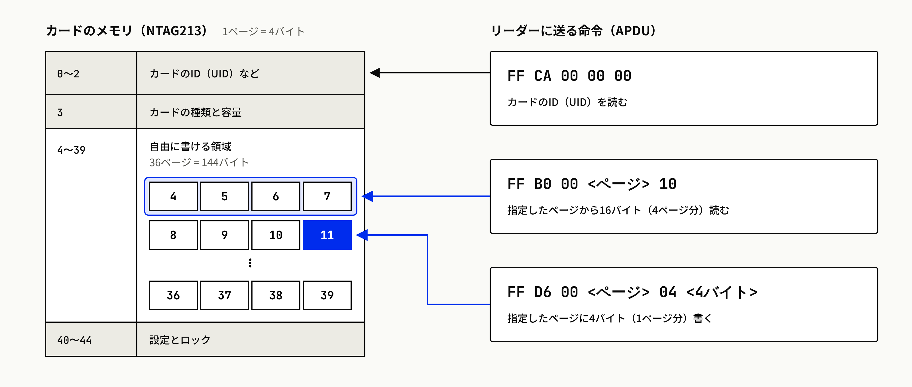
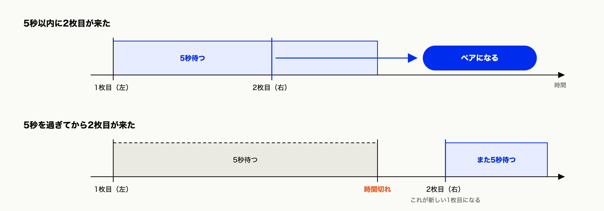

「Decode Frens」でHandShakeを展示しました。

- **会期**: 2026-11-21（土）14:00〜19:00
- **会場**: Crypto Cafe&Bar
- **主催**: Centrum

<blockquote className="twitter-tweet" data-dnt="true" align="center"><a href="https://twitter.com/0xCentrum/status/2118295311651332546">Centrum (@0xCentrum) のポスト</a></blockquote>
<blockquote className="twitter-tweet" data-dnt="true" align="center"><a href="https://twitter.com/seiya_oht/status/2123687287691345964">@seiya_oht のポスト</a></blockquote>
<script async src="https://platform.twitter.com/widgets.js" charset="utf-8"></script>

## HandShake

2枚のNFCをかざすことで出会いや繋がりを記録するシステム。




## 実装

全体の構成は次のとおり。図の青い線が、リーダーとやり取りするPC/SCの部分にあたる。


### PC/SCとPowerShellでリーダーを動かす

リーダーはSonyのPaSoRiで、RC-S300とRC-S380を1台ずつ使った。
最初はメーカーのSDKやnpmの専用ライブラリを探したが、[PC/SC](https://pcsclite.apdu.fr/api/group__API.html)を使えばどちらも要らないと分かったのが今回いちばんの発見だった。

PC/SC（Personal Computer/Smart Card）は、PCからICカードリーダーを扱うための標準規格だ。
WindowsにはPC/SCを使うための`winscard.dll`が最初から入っていて、リーダーがPC/SCに対応していれば同じ手順でカードを読み書きできる。
RC-S300はWindows標準のドライバーでそのまま動き、RC-S380はソニーのNFCポートソフトウェアを入れるとPC/SCのリーダーとして使えるようになる。

カードを読み書きするときは、リーダーにAPDUという決まった形のバイト列を命令として送る。
使ったカードのチップはNTAG213/215で、amiiboなどにも使われている定番のNFCチップだ。
NTAG213のユーザー領域は144バイトしかなく、中は4バイトごとの「ページ」に区切られている。
このカードを読み書きするのに必要な命令は3つだけだった。

| 命令（APDU） | すること |
| --- | --- |
| `FF CA 00 00 00` | カードのID（UID）を読む |
| `FF B0 00 <ページ> 10` | ページから16バイト読む |
| `FF D6 00 <ページ> 04 <4バイト>` | ページに4バイト書く |

メモリと命令の対応は次のようになる。



このバイト列を`winscard.dll`に渡せばカードを読み書きできる。
ただ、Node.jsから`winscard.dll`を直接呼ぶにはネイティブアドオンのビルドなどが必要になり面倒だった。
そこで、リーダーとのやり取りだけを受け持つ小さなスクリプトを、Windowsに標準で入っているPowerShellで書いた。
PowerShellはC#のコードを埋め込んで`winscard.dll`を呼べるので、Node.js用のネイティブライブラリやビルドツールを追加で入れなくて済む。

このスクリプトは2台のリーダーを見張り、カードがかざされたり離されたりするたびに、タブ区切りで1行ずつ出力する。

```text
CARD	SONY FeliCa Port/PaSoRi 4.0 0	04a1b2c3d4e5f69000
REMOVED	SONY FeliCa Port/PaSoRi 4.0 0
```

イベント種別・リーダー名・UIDの応答（末尾の`9000`は成功のステータス）が1行で届くので、展示機のElectronアプリは標準出力を読むだけでカードがかざされたと分かる。
カードに書くときも、命令のバイト列をスクリプトへ渡すだけだ。

ひとつハマったのは文字コードだった。
Windows PowerShell 5.1は、BOMのないファイルを日本語のWindowsではShift_JIS（CP932）として読む。
スクリプトに日本語を書くと壊れるので、英数字だけで書いている。

### そのほかの工夫

**「同時に」は5秒**

2人がぴったり同じ瞬間にカードをかざすことは、まずない。
そこで、1枚目がかざされてから5秒以内に反対側にもカードが来たら、ペアとして扱っている。
5秒を過ぎてから来たカードは、新しい1枚目としてまた5秒待つ。
最初は2秒にしていたが、展示当日に2枚目が間に合わない場面があったので5秒へ延ばした。



**途中で離されても壊れないように書く**

カードには、つながりマップを開くURLと記録データをNDEF形式で書き込んでいる（スマホをかざすとそのままマップが開く）。
展示では書き込みが終わる前にカードを離されることがあるため、最初に「中身は空」という印を書き、それから本文を書いて、最後に完成の印として本文の長さを書き、読み戻して確かめている。
途中で離されたカードは空のカードとして読めるので、次にかざしたときに書き直せる。


## 演出

1枚目をかざすと、反対側に「もう1枚、かざしてください」という文字と円が出る。円は残りの5秒に合わせて縮んでいく。

2枚がそろうと、まず読み込みの画面になる。
左右の名前は文字数だけを合わせた文字化けのような文字が次々に入れ替わり、つながりをデコードしているように見せる演出にした。

続いて左右から手が近づいて握手し、「FRENS!」の文字が出る。
会場のコーヒーにもNFCカードを用意していて、コーヒーのカードと一緒にかざしたときは、握手の代わりに手がテイクアウトのカップを受け取る。

握手のアニメーションはLottie（アニメーションをJSONで表し、Webで再生できる形式）だが、After Effectsは使っていない。
Fluent Emojiの3Dの手の画像を素材にして、Node.jsのスクリプトでLottieのJSONを書き出している。
手の位置と角度を1フレームずつ計算しているので、ぶつかる直前に溜めて、当たったら弾む、といった緩急をコードで直接調整できた。

## 参考

- [PC/SC API](https://pcsclite.apdu.fr/api/group__API.html)
- [Sony RC-S300/S仕様（PC/SC 2.0）](https://www.sony.co.jp/en/Products/felica/business/data/RC-S300-S_E.pdf)
